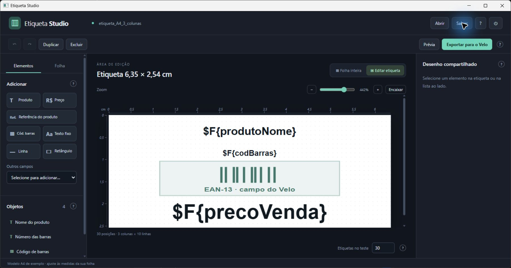

# Etiqueta Studio para Velo

Editor de etiquetas para Windows que gera **JRXML e JASPER compatíveis com JasperReports 3.7.2**. Abre em uma janela própria, sem lançar Chrome ou outro navegador.



## Baixar e usar

1. Abra [Releases](https://github.com/math7x/etiqueta-studio-velo/releases/latest).
2. Baixe **Etiqueta-Studio.exe** e abra o arquivo.
3. Configure a folha e desenhe a etiqueta. Use os ícones **?** para consultar cada função.
4. Clique em **Exportar para o Velo**, salve o pacote ZIP e importe o `.jasper` no sistema.

O executável inclui Java, JasperReports e os arquivos do editor. Não precisa manter pastas ao lado dele. Os componentes internos são preparados automaticamente na área local do aplicativo no Windows. A janela usa o Microsoft WebView2 do Windows; ele precisa estar disponível no computador. O programa é para Windows de 64 bits, com .NET Framework 4.6.2 ou superior.

## Recursos

- Folha A4 com linhas, colunas, tamanho da etiqueta, intervalos e margens em centímetros.
- Redimensionamento da grade ao alterar a quantidade de linhas ou colunas.
- Edição ampliada da etiqueta e visualização da folha inteira, com zoom.
- Nome do produto, referência, preço, outros campos do sistema e EAN-13.
- Arrastar, redimensionar, alinhar, organizar camadas, bloquear, duplicar e desfazer/refazer.
- Quebra de linha dentro da caixa de texto, sem alterar a altura física da etiqueta.
- Projetos salvos em JSON e importação de JRXML simples.
- Prévia, PDF de teste e folha de calibração. Imprima a calibração em **100%, tamanho real**.

O modelo A4 inicial é um exemplo de **3 colunas × 10 linhas**, com etiquetas de **6,35 × 2,54 cm**. Ajuste às medidas da sua folha. O modelo original de **3,2 × 2,2 cm** permanece disponível.

## Integração com o Velo

Os marcadores `$F{produtoNome}`, `$F{produtoDescricao}`, `$F{precoVenda}` e os demais campos são preenchidos pelo Velo na impressão. A prévia local usa produtos fictícios. A consulta original, os campos e os parâmetros foram preservados.

O editor não conecta ao banco do Velo. A impressão dos produtos continua pelo sistema, seguindo a paginação do modelo importado. Textos maiores que a caixa ainda precisam de uma caixa mais alta ou de uma fonte menor: o motor 3.7.2 não reduz a fonte automaticamente.

## Código e compilação

| Pasta | Conteúdo |
| --- | --- |
| `app/` | Interface e geração de JRXML |
| `src/` | Serviço Java, iniciador e janela Windows |
| `src/webview/` | SDK WebView2 e licença correspondente |
| `modelos/` | Exemplos de projeto e JRXML |
| `tests/` | Verificações de geometria e contrato do modelo |

Para compilar, instale o **JDK 7u80 de 32 bits**, o **iReport 3.7.2** e o .NET Framework com compilador C#. Confira os caminhos no início de `src/Compilar.ps1` e execute:

```powershell
.\src\Compilar.ps1
```

O resultado é `Etiqueta Studio.exe`, com os componentes incorporados. O JDK/iReport instalados são necessários para compilar, não para usar o executável pronto. Java e as bibliotecas do iReport não estão versionados neste repositório.

Para as verificações do gerador:

```powershell
node .\tests\core.test.cjs
```

## Validação

A versão inicial foi testada como arquivo único em uma pasta com espaços e acentos: abertura em janela Windows, prévia de 31 etiquetas em duas páginas, salvamento do projeto, compilação/recarga do JASPER e exportação do pacote com JRXML, JASPER e PDFs. O diálogo nativo de salvamento e o fechamento da janela também foram conferidos.

O alinhamento final depende de uma folha de teste na impressora usada. Antes de substituir um modelo em produção, confira a impressão no Velo.

## Componentes de terceiros

WebView2, Java e as bibliotecas JasperReports/iReport mantêm suas próprias licenças. A licença do SDK WebView2 está em `src/webview/LICENSE.txt`. Este repositório não altera as condições de distribuição desses componentes.
